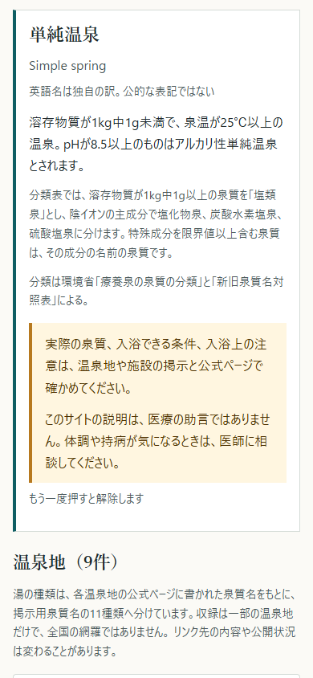

<div align="center">

# Onsen Finder / 温泉探し

**Find Japanese onsen areas by spring type. An unofficial, ad-free site that makes no requests to other sites.**<br>
**湯の種類（泉質）から温泉地を探す、非公式のサイトです。広告はなく、ほかのサイトへの通信もしません。**

[](LICENSE)
[](https://r38k51.github.io/onsen-guide/)
[](package.json)
[](#english)

[English](#english) · [日本語](#日本語)


<sub>Screens of the real site with its real data (some onsen areas only). / 実際のサイトと実際の収録データの画面です（収録は一部の温泉地だけです）。</sub>

</div>

<a id="english"></a>

## English

> [!NOTE]
> This is an unofficial site made by an individual. It is not affiliated with the Japan Onsen Association, the Ministry of the Environment, local governments, tourism associations, or lodgings. The spring-type tables come from Ministry of the Environment documents, used as sources and reorganized by us. The Ministry did not make this site.
>
> Tested only with Playwright's Chromium 1.64.1 (automated tests, 390 px and 1366 px wide screens). Not tested on real phones, other browsers, or other operating systems.

### Features

- Pick one of the 11 spring types used on onsen signs, and see the onsen areas listed for that type.
- Filter by prefecture too.
- Each area links to its official page, so you can check the details there.
- English and Japanese. English names are our own translations, not official terms.
- No ads, no bookings, no ratings, no prices, and no sign-up.
- It does not list effects or indications, and gives no medical advice.
- No cookies and no local storage. The language is kept in the page address (`#lang`).

### Requirements

- A recent web browser with JavaScript turned on.
- To run it on your own computer: Node.js 22 or later is needed only for the tests. The site itself needs only a simple web server.

### Usage

Open <https://r38k51.github.io/onsen-guide/>, choose a spring type, and read the description. Then open an area's official page to check it.

To run it on your own computer, download the files and serve the folder with any simple web server (for example, `python -m http.server`). Opening the file directly with `file:` does not work, because the page loads its data file.

```
npm install
npm test            # unit tests
npm run validate    # data and static checks
npm run test:e2e    # browser tests (Playwright)
```



### FAQ and limits

- **Does it send my data anywhere?** The page loads only its own files. It does not call other sites and has no analytics. Links to official pages open only when you click them, and those sites have their own policies. The browser tests found no requests to other sites.
- **Privacy.** The site is hosted on GitHub Pages. GitHub records the IP address of visitors under its own policy. The site itself keeps nothing.
- Only some onsen areas are included (21 at the time of writing). This is not a complete list of Japan.
- Some spring types have few or no areas listed. For example, "Copper-iron-containing spring" has none yet.
- Spring types follow each area's official page and the Ministry of the Environment classification tables. Please check signs and official pages at the place. Linked pages may change or disappear.

### License

MIT. See [LICENSE](LICENSE).

---

<a id="日本語"></a>

## 日本語

> [!NOTE]
> これは個人が作った非公式のサイトです。日本温泉協会、環境省、自治体、観光協会、宿泊施設とは関係がありません。泉質の分類表は環境省の資料を出典として使い、このサイトで整理し直したものです。環境省が作ったものではありません。
>
> 確かめた環境は、PlaywrightのChromium 1.64.1だけです（自動テスト、画面の幅390pxと1366px）。実際のスマホ、ほかのブラウザ、ほかのOSでは確かめていません。

### 特徴

- 温泉の掲示に使われる11種類の湯の種類（泉質）から1つ選ぶと、その種類の温泉地が一覧で出ます。
- 都道府県でも絞り込めます。
- 各温泉地に公式ページへのリンクがあり、詳しいことはそちらで確かめられます。
- 日本語と英語に対応しています。英語名は、このサイト独自の訳です。公的な表記ではありません。
- 広告、予約、評価、料金、登録はありません。
- 効能や適応症は載せておらず、医療の助言もしません。
- Cookie もブラウザの保存領域も使いません。言語は、ページのアドレス（`#lang`）に入ります。

### 必要なもの

- JavaScript が使える、新しめのWebブラウザ。
- 自分のパソコンで動かす場合：Node.js 22 以上はテストにだけ必要です。サイト自体は、簡単なWebサーバーがあれば動きます。

### 使い方

<https://r38k51.github.io/onsen-guide/> を開き、湯の種類を選んで説明を読みます。温泉地の公式ページを開いて確かめてください。

自分のパソコンで動かすには、ファイルをダウンロードし、フォルダを簡単なWebサーバー（例：`python -m http.server`）で開きます。ページがデータのファイルを読み込むため、`file:` で直接開いても動きません。

```
npm install
npm test            # 単体テスト
npm run validate    # データと静的な検査
npm run test:e2e    # ブラウザのテスト（Playwright）
```


### よくある質問と制限

- **データはどこかに送られますか？** ページが読み込むのは、このサイト自身のファイルだけです。ほかのサイトへの通信と、アクセス解析はありません。公式ページへのリンクは、押したときだけ開きます。開いた先のサイトには、そのサイトの規約があります。ブラウザのテストでも、ほかのサイトへの通信は見つかりませんでした。
- **プライバシー。** このサイトは GitHub Pages で公開しています。見た人のIPアドレスは、GitHub がその規約に従って記録します。サイト自体は何も保存しません。
- 収録は一部の温泉地だけです（書いた時点で21件）。全国の網羅ではありません。
- 温泉地が少ない、または0件の湯の種類があります。たとえば「含銅－鉄泉」は、まだ0件です。
- 湯の種類は、各温泉地の公式ページと、環境省の分類表に基づいています。現地の掲示と公式ページで確かめてください。リンク先は、変わったり、なくなったりすることがあります。

### ライセンス

MIT です。[LICENSE](LICENSE) を見てください。
