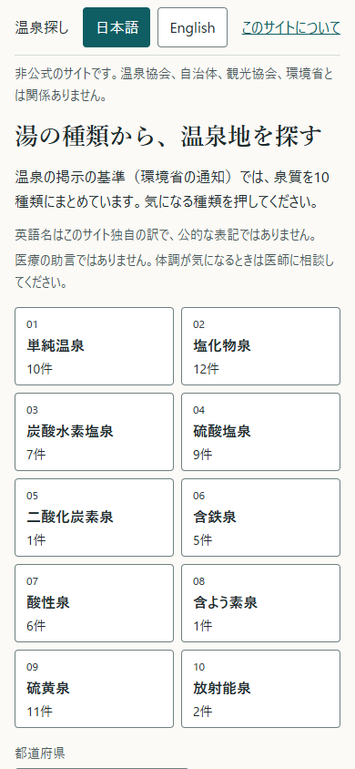
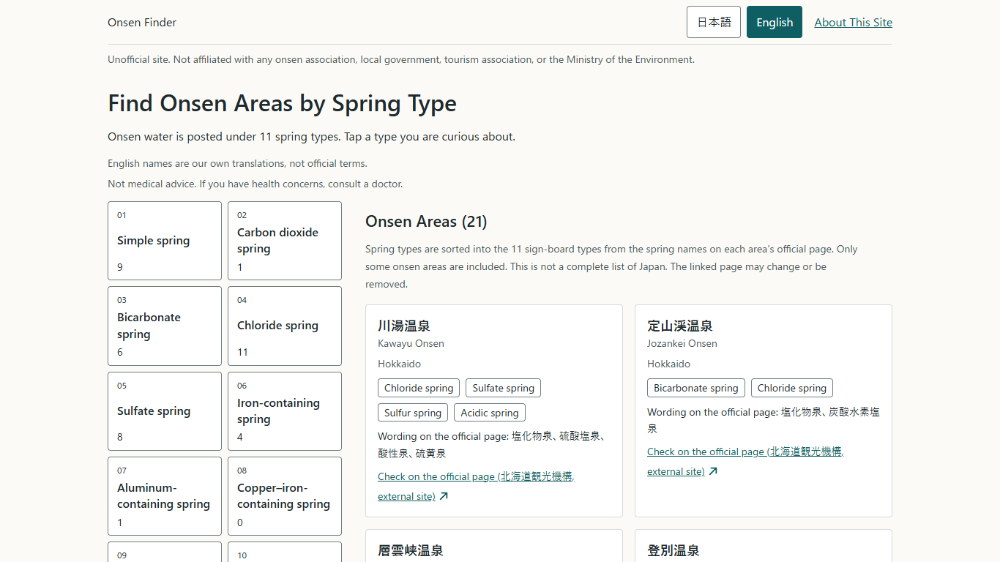

<div align="center">

# Onsen Finder / 温泉探し

**Find Japanese onsen areas by spring type, and see them on a map. No ads, no sign-up. The only outside requests are map tiles from GSI (Japan).**<br>
**湯の種類（泉質）から温泉地を探し、地図でも見られる非公式のサイトです。広告も登録もなく、通信するのは地図のタイル（国土地理院）のみ。**

[](LICENSE)
[](https://r38k51.github.io/onsen-guide/)
[](vendor/leaflet/)
[](#english)

[English](#english) · [日本語](#日本語)




<sub>Screens of the real site with its real data (some onsen areas only). / 実際のサイトと実際の収録データの画面です（収録は一部の温泉地だけです）。
<br>Map: GSI tiles (pale map) with this site's own pins added. / 地図：地理院タイル（淡色地図）に、このサイトが印を追記。</sub>

</div>

<a id="english"></a>

## English

> [!NOTE]
> This is an unofficial site made by an individual. It is not affiliated with the Japan Onsen Association, the Ministry of the Environment, local governments, tourism associations, or lodgings. The classification is based on Ministry of the Environment documents, summarized and edited by this site. The Ministry did not make this site.
>
> Tested only with the Chromium bundled with Playwright 1.64.1 (automated tests, screen widths of 390, 768, 1024, 1366 and 1920 px). Not tested on real phones, other browsers, or other operating systems.

### Features

- Pick one of the 10 spring types used on onsen signs, and see the onsen areas listed for that type.
- Filter by prefecture too.
- A map shows where the listed onsen areas are. Pins carry numbers that match the numbers on the cards. The map works with the keyboard too.
- Each area links to its official page, so you can check the details there.
- English and Japanese. English names are our own translations, not official terms.
- No ads, no bookings, no ratings, no prices, and no sign-up.
- It does not list effects or indications, and gives no medical advice.
- No cookies and no local storage. The language is kept in the page address (`#/?lang=en`).
- The pin positions are the approximate center of each area. Do not use them for navigation.

### Requirements

- A recent web browser with JavaScript turned on.
- To run it on your own computer: Node.js 22 or later is needed only for the tests. The site itself needs only a simple web server.

### Usage

Open <https://r38k51.github.io/onsen-guide/>, choose a spring type, and read the description. Then open an area's official page to check it.

To run it on your own computer, download the files and serve the folder with any simple web server (for example, `python -m http.server`). Opening the file directly with `file:` does not work, because the page loads its data file.

```
npm install
npm test            # unit tests
npm run validate    # data and static checks
npm run test:e2e    # browser tests (Playwright)
```


### FAQ and limits

- **Does it send my data anywhere?** The page loads its own files and, when the map is shown, map tiles for the visible area from the Geospatial Information Authority of Japan (GSI). GSI can see your IP address and the area you view. There is no analytics. Links to official pages open only when you click them, and those sites have their own policies. The browser tests allow requests only to this site and to GSI map tiles.
- **Privacy.** The site is hosted on GitHub Pages. GitHub records the IP address of visitors under its own policy. The site itself keeps nothing.
- Only some onsen areas are included (21 at the time of writing). This is not a complete list of onsen in Japan.
- Place names on the map are in Japanese, even when the site is in English. Pins close together overlap when the whole country is shown; zoom in to separate them.
- Some spring types have few areas listed. For example, "Carbon dioxide spring" and "Iodine-containing spring" have one each.
- Spring types follow each area's official page and the Ministry of the Environment classification tables. Please check signs and official pages at the place. Linked pages may change or disappear.

### Data sources

- `data/classification.json` (spring-type classification) was made from the Ministry of the Environment's "Guidelines for Mineral Spring Analysis" (revised 2014, 鉱泉分析法指針) and the notice on the signs required by Article 18 of the Hot Springs Act. Both are linked on the site's About screen.
- `data/onsen.json` (onsen areas) copies the spring-type names from the official pages of tourism associations and local governments, word for word. Each entry has its source URL and the date we checked it.
- Pin positions (`position` in `data/onsen.json`) are the approximate center of each area. Each entry gives its source: a Wikidata coordinate (CC0) or a position read by hand using GSI place-name search, based on the address on the official page. OpenStreetMap data is not used.
- The map images are GSI Tiles (Pale map) from the Geospatial Information Authority of Japan (<https://maps.gsi.go.jp/development/ichiran.html>). They are not stored or edited by this site; the site only overlays pins.
- Third-party: [Leaflet](https://leafletjs.com/) 1.9.4 (BSD-2-Clause, Copyright Volodymyr Agafonkin and CloudMade) is bundled in `vendor/leaflet/` with its license file.
- The Ministry of the Environment materials are used under the Public Data License, version 1.0 (PDL 1.0). Created by processing "Mineral Spring Analysis Guidelines (revised 2014)" (Ministry of the Environment) (https://www.env.go.jp/nature/onsen/docs/shishin_bunseki.pdf) and the notice on "Standards for posting contraindications and bathing or drinking precautions under Article 18, paragraph 1 of the Hot Springs Act" (Ministry of the Environment) (https://www.env.go.jp/nature/onsen/pdf/2-5_p_11.pdf). It was not made by the Ministry of the Environment.

### License

MIT. See [LICENSE](LICENSE). The MIT license covers only this site's code. The rights to the data belong to each source. Leaflet in `vendor/leaflet/` is under its own license (BSD-2-Clause).

---

<a id="日本語"></a>

## 日本語

> [!NOTE]
> これは個人が作った非公式のサイトです。日本温泉協会、環境省、自治体、観光協会、宿泊施設とは関係がありません。泉質の分類は環境省の資料をもとに、このサイトで要約・編集したものです。環境省が作ったものではありません。
>
> 確かめた環境は、Playwright 1.64.1 に付属の Chromium だけです（自動テスト、画面の幅390、768、1024、1366、1920px）。実際のスマホ、ほかのブラウザ、ほかのOSでは確かめていません。

### 特徴

- 温泉の掲示に使われる10種類の湯の種類（泉質）から1つ選ぶと、その種類の温泉地が一覧で出ます。
- 都道府県でも絞り込めます。
- 地図に、一覧にある温泉地の場所を印で出します。印の番号は、カードの番号と同じです。地図はキーボードでも使えます。
- 各温泉地に公式ページへのリンクがあり、詳しいことはそちらで確かめられます。
- 日本語と英語に対応しています。英語名は、このサイト独自の訳です。公的な表記ではありません。
- 広告、予約、評価、料金、登録はありません。
- 効能や適応症は載せておらず、医療の助言もしません。
- Cookie もブラウザの保存領域も使いません。言語は、ページのアドレス（`#/?lang=ja` の形）に入ります。
- 印の位置は、温泉地のおおよその中心です。目的地への案内には使わないでください。

### 必要なもの

- JavaScript が使える、新しめのWebブラウザ。
- 自分のパソコンで動かす場合：Node.js 22 以上はテストにだけ必要です。サイト自体は、簡単なWebサーバーがあれば動きます。

### 使い方

<https://r38k51.github.io/onsen-guide/> を開き、湯の種類を選んで説明を読みます。温泉地の公式ページを開いて確かめてください。

自分のパソコンで動かすには、ファイルをダウンロードし、フォルダを簡単なWebサーバー（例：`python -m http.server`）で開きます。ページがデータのファイルを読み込むため、`file:` で直接開いても動きません。

```
npm install
npm test            # 単体テスト
npm run validate    # データと静的な検査
npm run test:e2e    # ブラウザのテスト（Playwright）
```


### よくある質問と制限

- **データはどこかに送られますか？** ページが読み込むのは、このサイト自身のファイルと、地図を表示したときの地図のタイル（国土地理院）です。国土地理院には、あなたのIPアドレスと表示している範囲が見えます。アクセス解析はありません。公式ページへのリンクは、押したときだけ開きます。開いた先のサイトには、そのサイトの規約があります。ブラウザのテストでは、このサイトと地理院タイル以外への通信がないことを確かめています。
- **プライバシー。** このサイトは GitHub Pages で公開しています。見た人のIPアドレスは、GitHub がその規約に従って記録します。サイト自体は何も保存しません。
- 収録は一部の温泉地だけです（書いた時点で21件）。全国の網羅ではありません。
- 地図の地名は、サイトを英語にしても日本語のままです。日本全体を表示すると近い印は重なります。拡大すると分かれます。
- 温泉地が少ない湯の種類があります。たとえば「二酸化炭素泉」と「含よう素泉」は、1件ずつです。
- 湯の種類は、各温泉地の公式ページと、環境省の分類表に基づいています。現地の掲示と公式ページで確かめてください。リンク先は、変わったり、なくなったりすることがあります。

### データの出典

- `data/classification.json`（湯の種類の分類）は、環境省の「鉱泉分析法指針（平成26年改訂）」と、温泉法第18条の掲示の基準についての通知をもとに作りました。2つとも、サイトの「このサイトについて」の画面にリンクがあります。
- `data/onsen.json`（温泉地）は、各観光協会・自治体の公式ページにある泉質名を、原文のまま写したものです。1件ごとに、出典のURLと確認日があります。
- 印の位置（`data/onsen.json` の `position`）は、温泉地のおおよその中心です。1件ごとに、位置の出典（Wikidata の座標（CC0）か、手で読み取ったか）を書いています。手で読み取った件は、公式ページの所在地をもとに、国土地理院の地名検索で読み取りました。OpenStreetMap のデータは使っていません。
- 地図の画像は、国土地理院の「地理院タイル（淡色地図）」です（<https://maps.gsi.go.jp/development/ichiran.html>）。このサイトでは保存も加工もせず、印を重ねて表示するだけです。
- 外部の部品：[Leaflet](https://leafletjs.com/) 1.9.4（BSD-2-Clause、Copyright Volodymyr Agafonkin、CloudMade）を `vendor/leaflet/` に、ライセンスのファイルとともに同梱しています。
- 環境省の資料は、公共データ利用規約（第1.0版）に従って使っています。「鉱泉分析法指針（平成26年改訂）」（環境省）（https://www.env.go.jp/nature/onsen/docs/shishin_bunseki.pdf）、「温泉法第18条第1項の規定に基づく禁忌症及び入浴又は飲用上の注意の掲示等の基準」の通知（環境省）（https://www.env.go.jp/nature/onsen/pdf/2-5_p_11.pdf）を加工して作成。環境省が作成したものではありません。

### ライセンス

MIT です。[LICENSE](LICENSE) を見てください。MIT はこのサイトのコードに対するものです。データの権利は、それぞれの出典にあります。`vendor/leaflet/` の Leaflet は、Leaflet 自身のライセンス（BSD-2-Clause）です。
